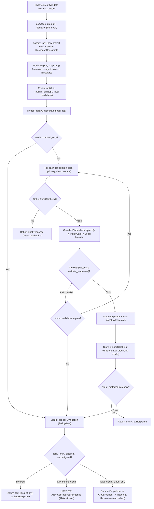
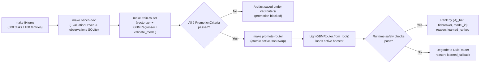

# Project Overview & Routing Architecture

`ecolm` is a single-user, local-first LLM broker with a React UI on loopback (`http://127.0.0.1:5173`), a single-worker FastAPI backend (`http://127.0.0.1:8000`), Ollama-backed local small language models (SLMs), and optional, explicitly gated OpenAI-compatible cloud fallback.

This document gives a brief overview of the project and a deep dive into the **routing mechanism and decision logic**—from prompt masking and task classification through feature extraction, candidate eligibility, baseline rules ranking, LightGBM learned routing, local cascade, exact-cache reuse, and policy-gated cloud fallback.

---

## 1. Project Overview & Architectural Context

### Core Design Principles

1. **Local-first by default:** Requests default to `ExecutionMode.LOCAL_ONLY` and `SensitivityScope.UNSPECIFIED`. Cloud egress is off unless explicitly enabled per request and permitted by policy.
2. **Privacy before routing:** Prompts and conversation history are scanned and masked *before* task classification, feature extraction, or routing. Only a trusted `SanitizedPayload` (issued in-memory by `Sanitizer`) can enter downstream stages.
3. **Separation of powers:**
   - **Routers (`Router` protocol)** are *pure, stateless pre-generation rankers*. They never import provider adapters, read secrets, mutate model state, or authorize egress.
   - **Registry (`ModelRegistry`)** tracks reviewed catalog manifests reconciled against read-only runtime observations (`OllamaLocalControl.observe()` or mock inventory) and issues immutable `RegistrySnapshot`s and `RosterLease`s.
   - **Policy Gate & Guarded Dispatcher (`PolicyGate` / `GuardedDispatcher`)** form the sole door to text generation (`generate` / `warm_up`), enforcing budgets, hard-blocked PII types, execution modes, and single-use cloud approvals.
   - **Lifecycle Coordinator (`SwapCoordinator`)** handles manual, owner-approved model pulls/unloads/removals separately from per-request routing.

### Package Map

| Package / Path | Responsibility |
| --- | --- |
| [`backend/api/`](../backend/api/main.py) | Loopback FastAPI app factory, Pydantic contracts, `Host`/`Origin` & `X-Local-Token` boundary middleware |
| [`backend/broker/`](../backend/broker/chat.py) | Orchestration (`ChatOrchestrator`), guarded dispatch (`GuardedDispatcher`), policy gate, task classifier, structural validators, feature extractor, `RuleRouter`, `LightGBMRouter` |
| [`backend/privacy/`](../backend/privacy/sanitizer.py) | Presidio/regex analyzer, fail-closed `Sanitizer`, `SanitizedPayload` seal, request-local `PlaceholderMap`, `OutputInspector` |
| [`backend/model_management/`](../backend/model_management/registry.py) | Catalog manifests, hardware probes, read-only `ModelRegistry` snapshots/leases, `SwapCoordinator` |
| [`backend/cache/`](../backend/cache/exact_cache.py) | Opt-in SQLite exact cache keyed by canonical prompt/task/model/version/mode/scope/options |
| [`backend/providers/`](../backend/providers/base.py) | `OllamaProvider`, `CloudProvider` (OpenAI-compatible), `MockProvider`, read-only `OllamaLocalControl` |
| [`backend/learning/`](../backend/learning/training/trainer.py) | Synthetic benchmarks, category scorers, `ObservationStore`, LightGBM vectorizer/trainer/validator/promoter |
| [`backend/telemetry/`](../backend/telemetry/recorder.py) | Opt-in, content-free allowlisted SQLite telemetry with `< 30`-sample suppression |
| [`backend/config/`](../backend/config/loader.py) | Validated YAML configs (`settings.yaml`, `policy.yaml`, `catalog.yaml`, `pricing.yaml`) |
| [`frontend/src/`](../frontend/src/App.tsx) | React + Vite chat UI, generated OpenAPI client, approval modal, settings, telemetry dashboard |

---

## 2. End-to-End Routing & Dispatch Pipeline

Every chat turn executes the fixed sequence inside [`ChatOrchestrator.chat`](../backend/broker/chat.py):



### Key Pre-Routing Isolation Rules

1. **Transcript vs. Classification Input:**
   - [`compose_prompt`](../backend/broker/chat.py) prepends a background timestamp header and any [`constraint_directives`](../backend/broker/prompting.py) to the conversation history plus `request.prompt`, and masks the entire composed text as one unit so repeated sensitive identifiers across turns keep consistent placeholders.
   - However, when `request.history` is non-empty, `ChatOrchestrator.chat` runs a second `Sanitizer.sanitize(request_id, request.prompt)` call solely for [`classify_task`](../backend/broker/classifier.py), then immediately clears that temporary placeholder map. This prevents an earlier turn (e.g., a code question) from causing all subsequent turns in the conversation to be classified as `code`.
2. **Fail-Closed Privacy:** If sanitization fails, `ChatOrchestrator.chat` returns `ErrorCode.PRIVACY_FAILED` with zero routing or provider calls. Downstream components (`classify_task`, `extract_features`, `RuleRouter`, `LightGBMRouter`, `PolicyGate`) all re-verify `SanitizedPayload.is_trusted` and reject deserialized or forged payloads.

---

## 3. Stage 1 — Deterministic Task Classification & Constraints

[`classify_task`](../backend/broker/classifier.py) assigns every request to one of the seven `TaskCategory` values (`qa`, `summarise`, `extract`, `classify`, `reason`, `format`, `code`) and emits a content-free `ClassificationReason`.

### Precedence Order

Rules are evaluated strictly top-to-bottom; the first match wins:

| Priority | Condition | Assigned `TaskCategory` | `ClassificationReason` |
| --- | --- | --- | --- |
| 1 | `request.task_hint` is set | `task_hint` | `user_hint` |
| 2 | `constraints.required_fields` is non-empty | `extract` | `required_fields` |
| 3 | Explicit shape constraint (`requires_json`, `min_bullets` / `max_bullets`, `min_chars > 1`, `max_chars < 64_000`) **or** `_FORMAT` regex (`json schema`, `as/in [valid] json`, or `return/respond/output/format/produce ... json/csv/xml/yaml/table/bullet(s)`) | `format` | `shape_constraint` |
| 4 | `_CODE` regex (` ``` ` fence, or `write/implement/debug/fix/refactor/generate/review/explain` within 100 chars of `code/function/script/program/python/javascript/typescript/sql/rust/java`) | `code` | `code_cue` |
| 5 | `_EXTRACT` regex (`extract`, `extraction`, `pull out`) | `extract` | `extraction_cue` |
| 6 | `_SUMMARY` regex (`summarise`, `summarize`, `summary`, `condense`, `abridge`) | `summarise` | `summary_cue` |
| 7 | `constraints.allowed_labels` is non-empty **or** `_LABEL` regex (`classify`, `classification`, `categorise/categorize`, `label`, `choose/select/return [exactly] one of/label`) | `classify` | `label_cue` |
| 8 | `_REASON` regex (`reason`, `reasoning`, `deduce`, `derive`, `prove`, `solve`, `calculate`, `why`, `compare`, `step-by-step`) | `reason` | `reasoning_cue` |
| 9 | Default when no rule matches | `qa` | `qa_fallback` |

*Design note:* Shape constraints (`required_fields` and `_FORMAT`) precede `_CODE`, and `_CODE` precedes `_EXTRACT`, so a request like `"Write a Python function to extract records"` classifies as `code`, whereas `"Return JSON ..."` classifies as `format`.

### Automatic Constraint Inference & Directives

When `task == TaskCategory.FORMAT` and the caller left `request.constraints` at its default (`ResponseConstraints()`), [`ChatOrchestrator._constraints`](../backend/broker/chat.py) inspects the sanitized prompt:
- If `\bjson\b` matches, it sets `ResponseConstraints(response_format=ResponseFormat.JSON)`.
- Else if `(exactly|return|use) <N> bullet(s)` matches, it sets `min_bullets = max_bullets = N`.

These constraints drive both prompt instructions ([`constraint_directives`](../backend/broker/prompting.py), bounded to `1200` chars) and post-generation structural validation ([`validate_response`](../backend/broker/validators.py)), which determines whether a local response passes or triggers a cascade/fallback.

---

## 4. Stage 2 — Candidate Eligibility, Snapshots & Leases

Before a router ranks anything, [`ModelRegistry`](../backend/model_management/registry.py) captures an immutable `RegistrySnapshot` pairing the reviewed catalog ([`backend/config/catalog.yaml`](../backend/config/catalog.yaml)) with the latest `RuntimeInventory` and `HardwareContext`.

### Catalog & Managed Cap

- The managed roster holds at most **3 installed models** (`managed_model_limit: 3` in `settings.yaml`, enforced by `RosterSnapshot` and `ModelRegistry._build`).
- Any unrelated models present in Ollama (e.g., an external model already pulled by the user) are ignored by reconciliation and never modified or routed to.

### Eligibility Filtering

`ModelRegistry._build` evaluates every catalog manifest in deterministic `id` order and assigns one `EligibilityReason`:

1. `runtime_unavailable` — runtime inventory is unavailable.
2. `catalog_only` — `runtime_tag` not present in observed runtime inventory.
3. `unverified` — (real mode only) `manifest.verification != VERIFIED` (excludes `placeholder-*` entries).
4. `identity_mismatch` — (real mode only) observed runtime digest does not match `manifest.pinned_digest`.
5. `unhealthy_or_unknown` — `observation.healthy is not True`.
6. `platform_unknown` / `platform_unsupported` — (real mode only) host `HardwareContext.platform` is missing or not in `manifest.platforms`.
7. `memory_unknown` / `memory_insufficient` — (real mode only) host `ram_bytes` or `manifest.memory_bytes` is `None`, `manifest.memory_bytes > hardware.ram_bytes`, or `license_review.status != APPROVED`.
8. `eligible` — all checks pass; added to `snapshot.eligible_model_ids`.

Both `RuleRouter` and `LightGBMRouter` re-validate the incoming `RegistrySnapshot`, verify that `hardware.version == snapshot.hardware_version` (rejecting mismatched overrides with `RoutingError`), and filter `roster.entries` by:
`entry.manifest.id in roster.eligible_model_ids and entry.installed and entry.healthy and (roster.mock_mode or entry.manifest.verification == VERIFIED)`.

### Request Leases

Once `Router.rank` returns a `RoutingPlan` (up to 2 unique `model_ids`), `ChatOrchestrator.chat` calls `self.registry.lease(plan.model_ids, snapshot=snapshot)`. The `RosterLease` pins those candidates against the captured snapshot generation for the duration of dispatch and is always released in `finally` (or on approval expiry/disposal).

---

## 5. Stage 3 — Shared Pre-Generation Features (`FeatureRow`)

Both live inference routers (`RuleRouter`, `LightGBMRouter`) and offline benchmark collection (`EvaluationDriver`) extract the exact same [`FeatureRow`](../backend/broker/feature_extractor.py) contract (`schema_version = "routing-features-v1"`, pinned by `FEATURE_SCHEMA_HASH`).

### Placeholder Normalization & Privacy

Before computing lexical counts, [`extract_features`](../backend/broker/feature_extractor.py) replaces every request-local placeholder (`[[PII_<32-hex>_<TYPE>_<N>]]`) with the fixed token `MASKED_ENTITY` so randomized per-request hex IDs do not distort token estimates or character/digit counts. No raw prompt text, placeholder map values, request IDs, or post-generation metrics ever enter `FeatureRow`.

### Feature Schema (29 Fields)

| Group | Fields | Notes |
| --- | --- | --- |
| **Schema** | `schema_version`, `schema_hash` | Validated on model construction; schema drift triggers `LightGBMRouter` fallback |
| **Request lexical / structural** | `task`, `sanitized_char_count`, `sanitized_token_estimate`, `line_count`, `question_count`, `digit_count`, `bullet_line_count`, `bracket_count`, `has_json_cue`, `has_code_fence` | Lexical regex token estimate (`\w+\|[^\w\s]`), not runtime tokenizer count |
| **Candidate identity** | `candidate_id`, `candidate_manifest_version`, `candidate_weight_digest`, `candidate_family`, `candidate_quantization` | From `ModelManifest` |
| **Candidate priors** | `capability_quality`, `capability_latency_ms`, `capability_provenance`, `capability_benchmark_version` | Filtered by `capability_for()`: `SYNTHETIC` priors are **ignored** when `mock_mode=False`, returning `None` / `UNKNOWN` |
| **Runtime status** | `installed`, `healthy`, `resident` | `resident` can be `True`, `False`, or `None` (unknown) |
| **Hardware context** | `hardware_platform`, `hardware_ram_bytes`, `hardware_vram_bytes`, `hardware_cpu_threads`, `hardware_version` | From `HardwareContext` |

---

## 6. Stage 4 — Baseline Router (`RuleRouter`)

[`RuleRouter`](../backend/broker/rule_router.py) is the deterministic, zero-ML baseline and permanent fallback router (`router_type = "rules"`).

### Utility Formula

For each eligible candidate, `RuleRouter.rank_details` computes:

$$U = w_q \cdot q - w_\ell \cdot \ell_{\text{norm}} - w_m \cdot p_{\text{load}}$$

Where:
- **Weights** come from `PreferenceProfile.weights` (defaults from [`backend/config/settings.yaml`](../backend/config/settings.yaml): `quality = 1.0`, `latency = 0.3`, `load = 0.1`).
- **Quality prior ($q$):** `row.capability_quality` if present, else **`0.0`** (conservative unknown fallback).
- **Normalized latency ($\ell_{\text{norm}}$):**
  $$\ell_{\text{norm}} = \begin{cases} \min\left(\dfrac{\text{capability\_latency\_ms}}{\text{latency\_reference\_ms}},\; 1.0\right) & \text{if known} \\ 1.0 & \text{if unknown} \end{cases}$$
  Default `latency_reference_ms = 1000.0` (fixed reference so removing or adding another candidate never rescales an existing candidate's score).
- **Cold-start penalty ($p_{\text{load}}$):**
  $$p_{\text{load}} = \begin{cases} 0.0 & \text{if } \text{resident is True} \\ \text{nonresident\_load\_penalty} \text{ (default } 1.0\text{)} & \text{if } \text{resident is False} \\ \text{unknown\_load\_penalty} \text{ (default } 1.0\text{)} & \text{if } \text{resident is None} \end{cases}$$

### Sorting, Tie-Breaking & `RoutingPlan`

Candidates are sorted by:

```python
key = lambda item: (-item.utility, not item.declares_task, item.model_id)
```

and sliced to the top **2** candidates (`[:2]`) for primary + local cascade execution.

- `declares_task` is `True` if `entry.manifest.capability_benchmark` contains an entry matching `task`, **even if `provenance == "unknown"` and `quality is None`**.
- **How `declares_task` interacts with unbenchmarked real catalogs:**
  In [`backend/config/catalog.yaml`](../backend/config/catalog.yaml), `qwen25-1-5b` declares `(qa, summarise, reason)`, `qwen25-coder-1-5b` declares `(code, format, extract)`, and `qwen25-0-5b` declares `(qa, classify)`, all with `provenance: unknown`.
  - When both installed models have equal residency (e.g., both non-resident), both get `utility = 1.0*0.0 - 0.3*1.0 - 0.1*1.0 = -0.4`. The tie breaks on `not item.declares_task`, routing `code`/`format`/`extract` to `qwen25-coder-1-5b` and `qa`/`summarise`/`reason` to `qwen25-1-5b`.
  - **Residency caveat:** If one model is already `resident=True` (Ollama 60s keep-alive) and the other is `resident=False`, the resident model scores `-0.3` vs `-0.4`, so **utility differs by `+0.1` and residency outranks `declares_task`** whenever quality/latency priors are unmeasured.
- **Emitted `RoutingReason`:**
  - `no_eligible_model` if no candidates are eligible.
  - `rules_fallback` if any selected top-2 candidate has unknown quality or unknown latency.
  - `rules_ranked` if all selected top-2 candidates have measured (or mock-synthetic) quality and latency priors.

---

## 7. Stage 5 — Learned Router (`LightGBMRouter`) & ML Pipeline

[`LightGBMRouter`](../backend/broker/lightgbm_router.py) implements the same `Router` protocol using a promoted `TrainingArtifact` containing a native LightGBM regression booster (`LGBMRegressor`) that predicts candidate quality $\hat{Q} \in [0, 1]$ from `(request features, candidate features, hardware features)`.



### 7.1 Benchmark Corpus & Splits ([`backend/learning/benchmarks/`](../backend/learning/benchmarks/splits.py))

- `make fixtures` deterministically generates **300** synthetic tasks across all 7 `TaskCategory` values (`qa`: 45, `summarise`: 42, `extract`: 45, `classify`: 45, `reason`: 42, `format`: 42, `code`: 39) grouped into **100** paraphrase families.
- Family-aware hashing (`benchmarks-split-v1`) splits families 7/10 vs 3/10 into `dev_train` (**216 tasks**) and `dev_validation` (**84 tasks**) with zero family crossover. `make verify-splits` checks committed fixtures against generators.

### 7.2 Observation Collection ([`EvaluationDriver`](../backend/broker/evaluation.py) & [`CollectionRunner`](../backend/learning/collection/runner.py))

- `make bench-dev SPLIT=<split> LIMIT=<n|all>` runs each `(task, candidate)` pair individually through `EvaluationDriver` (bypassing cache, cascade, and cloud, while still enforcing `Sanitizer`, `ModelRegistry.lease`, `PolicyGate`, and `OutputInspector`).
- Each call records the exact `FeatureRow` used at dispatch, status, latency breakdown, token counts, and an objective category-specific `ScoreResult` (`quality ∈ [0, 1]` kept separate from `format_valid: bool`):
  - `qa` / `reason`: normalized exact / token match
  - `summarise`: pure-Python ROUGE-L F1
  - `classify`: closed-label exact match
  - `extract`: field-level F1 over parsed JSON
  - `format`: strict schema/type/extra-key validation
  - `code`: isolated offline subprocess test execution (`python -E -s`, minimal env, 3s timeout)

### 7.3 Feature Vectorization & Model Training

[`vectorizer.py`](../backend/learning/training/vectorizer.py) converts `FeatureRow` into a deterministic 23-column `float32` matrix:
- **17 numeric columns** (`sanitized_char_count`, `sanitized_token_estimate`, `line_count`, `question_count`, `digit_count`, `bullet_line_count`, `bracket_count`, `has_json_cue`, `has_code_fence`, `capability_quality`, `capability_latency_ms`, `installed`, `healthy`, `resident`, `hardware_ram_bytes`, `hardware_vram_bytes`, `hardware_cpu_threads`), with `None` encoded as `NaN` for LightGBM's native missing-value handling.
- **6 categorical columns** (`task`, `candidate_id`, `candidate_family`, `candidate_quantization`, `capability_provenance`, `hardware_platform`), mapped via ordered `CategoricalEncoder` vocabularies learned on training samples (`-1` sentinel for unseen values).

[`trainer.py`](../backend/learning/training/trainer.py) trains a native LightGBM booster (`objective="regression"`, `metric="l2"`, `num_leaves=15`, `learning_rate=0.08`, `feature_fraction=0.9`, `min_data_in_leaf=4`, `num_boost_round=60`, `seed=20260101`).

### 7.4 Group-Aware Validation & Promotion Gates

[`validate_model`](../backend/learning/training/validator.py) evaluates the trained booster on `dev_validation`, grouping predictions per `task_id` to compute:
- Sample-level **MAE** and **$R^2$**
- Mean quality of the **hindsight oracle**, **learned router** ($\arg\max \hat{Q}$), and simulated **rules baseline** (`_rules_pick` using `capability_quality` + ID tiebreak)
- **Regret improvement** (`rules_regret - router_regret`)

Before `promote_artifact` can point `var/routers/active.json` at an artifact (saving `active.json.bak` for rollback via `rollback_active`), all predeclared [`PromotionCriteria`](../backend/learning/training/types.py) gates must pass:
- `min_train_samples >= 16` (checked at CLI), `min_validation_samples >= 8`
- `min_distinct_families >= 2`, `min_distinct_tasks >= 2`, `min_distinct_candidates >= 2`
- `max_validation_mae <= 0.35`, `min_validation_r2 >= 0.0`
- `require_regret_improvement = True` with `regret_improvement >= 0.0`
- `nan_prediction_count == 0`, `unseen_category_count == 0`, `unseen_candidate_count == 0`

### 7.5 Live Inference & Automatic Rules Fallback

At runtime, `LightGBMRouter.rank` extracts `FeatureRow` for each eligible candidate, builds the 23-column vector using the artifact's saved `CategoricalEncoder`s, predicts $\hat{Q}_i$, and selects the top 2 candidates sorted by:

```python
key = lambda idx: (
    -float(predictions_array[idx]),
    -_latency_tiebreaker(candidate_rows[idx][2], profile),
    candidate_rows[idx][0],
)
```

where `_latency_tiebreaker(features, profile)` computes `profile.weights.latency * latency_penalty + profile.weights.load * residency_bonus` (using `capability_latency_ms` or `1_000_000.0` if unknown, and `0.0` if `resident` else `1.0`).

**Single-request rules fallback (`RoutingReason.LEARNED_FALLBACK`, `router_version=None`):**
`LightGBMRouter` transparently delegates to its embedded `RuleRouter` whenever:
1. No `active.json` pointer exists or `artifact.json` fails validation / `booster_sha256` checksum check.
2. `feature_schema_version`, `feature_schema_hash`, `feature_order`, or `categorical_features` differs from the running code.
3. `lgb.Booster(model_str=...)` fails to parse.
4. Feature extraction raises an error.
5. `task` or any eligible `candidate_id` is absent from the trained encoder vocabulary. (Unseen `candidate_family`, `candidate_quantization`, `capability_provenance`, or `hardware_platform` map to `-1` and do **not** trigger fallback.)
6. Any predicted score is `NaN`.

> **Current wiring note:** `LightGBMRouter` is implemented, unit-tested ([`tests/learning/test_lightgbm_router.py`](../tests/learning/test_lightgbm_router.py)), and E2E-tested with `ChatOrchestrator` ([`tests/integration/test_router_modes.py`](../tests/integration/test_router_modes.py)). Currently, [`create_app`](../backend/api/main.py), `build_mock_broker`, and `build_real_broker` default `router=None` (instantiating `RuleRouter()`); callers must pass `LightGBMRouter.from_root(...)` explicitly until wired into server startup.

---

## 8. Stage 6 — Execution Routing: Cache, Cascade, Hardware Preflight & Cloud

Once `Router.rank` produces a `RoutingPlan`, [`ChatOrchestrator.chat`](../backend/broker/chat.py) executes it across three layers:

### 8.1 Opt-In Exact Cache (Post-Routing, Pre-Dispatch)

Cache lookup runs *after* routing so each candidate in `local_plan` is checked under its own identity:
- **Eligibility ([`cache_eligible_request`](../backend/cache/eligibility.py)):** Requires `exact_cache_enabled = True`, `sensitivity_scope == NON_SENSITIVE`, `pii_count == 0` (no PII detected), and `not request.history` (multi-turn conversations always bypass the cache).
- **Key ([`exact_cache_key`](../backend/cache/key.py)):** Canonical hash of `(prompt, task, model_id, model_version, mode, sensitivity_scope, options)`.
- **Hit:** Returns immediately with `route="local"`, `reason="exact_cache_hit"`, `cache_status="exact_hit"`, and `CacheProvenance` matching the producing `(model_id, model_version, POLICY_VERSION, SCHEMA_VERSION)`.
- **Store:** Only locally generated responses that pass both `validate_response` and `OutputInspector` are stored, always under the *actual producing* `(model_id, model_version)`—a cascaded answer from model B is never stored under model A.

### 8.2 Local Cascade & Resource Preflight

For each `(model_id, version)` in `local_plan` (unless `mode == CLOUD_ONLY`):
1. **Identity check:** Verifies `entry.manifest.version == version` and `ProviderDescriptor.model_version` matches `manifest.version` (mock) or `manifest.pinned_digest` (real).
2. **Guarded dispatch:** `GuardedDispatcher.dispatch` enters `PolicyGate.authorize` (60s local budget, at most 1 `retryable_connection` retry).
   - In real mode, `OllamaProvider` invokes `LocalResourceMonitor.permitted(model_id)` ([`backend/broker/local_runtime.py`](../backend/broker/local_runtime.py)), which refreshes runtime/hardware state and enforces `pressure == "normal"`, `available_ram_bytes - 1 GiB >= required`, `resident_count <= resident_limit`, and `resident_bytes + required <= memory_budget`.
   - On 16 GiB machines with ~2.6 GiB free RAM while model 1 is resident (~1.35 GiB measured, 2 GiB catalog estimate), a cascade to model 2 can be blocked by the conservative headroom check.
3. **Failure vs. Cascade:**
   - `POLICY_BLOCKED`, `APPROVAL_CONFLICT`, or `INTERNAL` abort immediately without cascading.
   - Any other `ProviderFailure` or `validate_response(local.text, constraints)` failure records `failed_local` / `failed_validation` and cascades to the second candidate in `local_plan`.
4. **Local Success:** Passes `OutputInspector.inspect` (restoring valid placeholders locally; blocking on new PII or forged tokens), optionally stores in `ExactCache`, and checks whether `task in policy.cloud_preferred_categories`. If not (the default), returns immediately with `reason="local_primary"` or `"local_cascade"`.

### 8.3 Policy-Gated Cloud Fallback

If local execution did not produce an accepted final response (or `mode == CLOUD_ONLY`, or `cloud_preferred_categories` matched), `ChatOrchestrator` evaluates the cloud branch:

1. **Destination selection (`_cloud_model_id`):** Picks the first declared/owner-added cloud destination holding an active API key (`key_available`), or falls back to the first declared destination so `PolicyGate` produces an explicit policy/unavailable error.
2. **Fallback reason determination:**
   - `CLOUD_ONLY` if `mode == ExecutionMode.CLOUD_ONLY`
   - `CLOUD_PREFERRED` if `best_local` succeeded and `task in policy.cloud_preferred_categories`
   - `NO_LOCAL_MODEL` if `plan.model_ids` is empty and `policy.allow_no_local_model_cloud` is `True`
   - `VALIDATION_FAILURE` if local candidates failed structural validation and `validation_failure` is in `policy.allowed_fallback_reasons`
   - `LOCAL_ERROR` if local candidates failed dispatch and `local_error` is in `policy.allowed_fallback_reasons`
3. **`PolicyGate` enforcement ([`backend/broker/policy_gate.py`](../backend/broker/policy_gate.py)):**
   - Refuses `ExecutionMode.LOCAL_ONLY`.
   - Refuses if any detected PII type is in `policy.hard_block_entity_types` (default `["CREDIT_CARD", "US_SSN"]`).
   - Validates HTTPS endpoint, exact `reason` / `mode` pairing, `key_available`, and remaining compute budget (`30s` cloud budget, `0` cloud retries).
   - Under `ASK_BEFORE_CLOUD`: pauses the compute budget, issues a `CloudProposal` bound to `(request_id, digest, target_fingerprint, model_id, model_version, endpoint, mode, policy_version, options_digest, reason, sanitized_preview)` with a **120s** expiry, and returns HTTP `202` (`ApprovalRequiredResponse`, including `best_local_answer` if `cloud_preferred`). Resuming via `POST /api/chat/{request_id}/approval` atomically consumes the single-use `ApprovalReceipt` once.
   - Under `AUTO_CLOUD` or `CLOUD_ONLY`: dispatches directly through `GuardedDispatcher`. Cloud answers are inspected/restored locally and are **never cached**.

---

## 9. Observability, Configuration & CLI Reference

### Response & Telemetry Fields

Every `ChatResponse` surfaces routing metadata directly to the UI and opt-in telemetry (`TelemetryStore`):
- `route`: `"local"` or `"cloud"`
- `model_id`, `model_version`, `manifest_version`
- `reason`: `"local_primary"`, `"local_cascade"`, `"exact_cache_hit"`, or the `CloudFallbackReason` value
- `task`: classified `TaskCategory`
- `router_type`: `"rules"` or `"lightgbm"`
- `router_version`: `RuleRouter.config_version`, active LightGBM `artifact_id`, or `"rules-fallback"`
- `timings`: `total_ms`, `privacy_ms`, `routing_ms`, `generation_ms`

### Routing & Learning Commands (`Makefile`)

| Command | Mode / Safety | Purpose |
| --- | --- | --- |
| `make demo-routing` | Offline synthetic | Runs `scripts/demo_routing.py` to demonstrate classify → `RuleRouter.rank` → lease → structural validation without generation |
| `make fixtures` / `make verify-splits` | Offline synthetic | Generates or hash-verifies the 300-task family-disjoint benchmark corpus under `evaluation/datasets/` |
| `make benchmark-plan SPLIT=dev_train LIMIT=20` | Dry-run | Counts planned `(task × candidate)` evaluations without dispatching |
| `make bench-dev SPLIT=dev_train LIMIT=all` | Mock by default (`MOCK_MODE=0` for Ollama) | Collects per-candidate observations and `FeatureRow`s into `var/bench/` |
| `make train-router TRAIN_RUN=<id> VAL_RUN=<id>` | Offline | Fits `LGBMRegressor`, evaluates `validate_model` gates, writes artifact to `var/routers/<id>/` (never auto-activates) |
| `make promote-router VERSION=<id>` | Offline | Atomically updates `var/routers/active.json` (with `active.json.bak` rollback support) |
| `make test` / `make release-check` | Offline mocked | Runs Ruff, strict mypy, secret/security audit, pytest (`test_rule_router.py`, `test_classifier.py`, `test_features.py`, `test_lightgbm_router.py`, `test_router_modes.py`, `test_dispatch_boundary.py`), frontend tests, and Playwright smoke |
